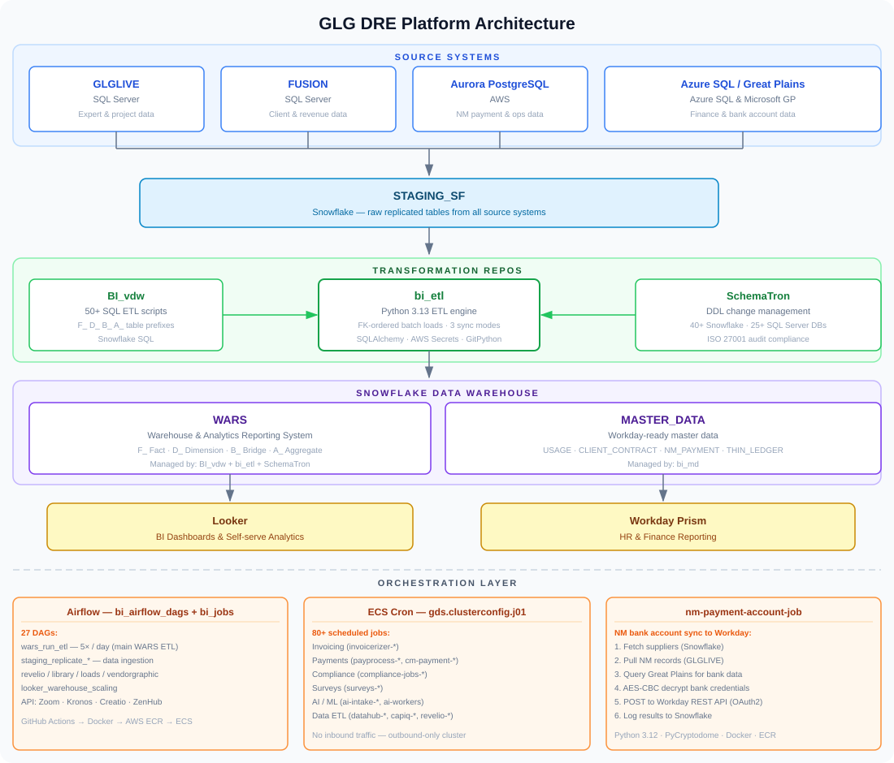

# Adeshwar-local

Personal knowledge base and documentation for GLG DRE (Data and Reporting Engineering) repositories.

## Repository Docs

| Repository | Description | GitHub | Doc |
|---|---|---|---|
| `BI_vdw` | WARS data warehouse — 50+ SQL ETL scripts for Snowflake | [glg/BI_vdw](https://github.com/glg/BI_vdw) | [BI_vdw.md](./BI_vdw.md) |
| `DE_NewHireTraining` | DRE team new hire onboarding guide | [asinghtyagi/DE_NewHireTraining](https://github.com/asinghtyagi/DE_NewHireTraining) | [DE_NewHireTraining.md](./DE_NewHireTraining.md) |
| `SchemaTron` | Database schema change management (ISO 27001) | [glg/SchemaTron](https://github.com/glg/SchemaTron) | [SchemaTron.md](./SchemaTron.md) |
| `bi_airflow_dags` | All Airflow DAG definitions (27 DAGs) | [glg/bi_airflow_dags](https://github.com/glg/bi_airflow_dags) | [bi_airflow_dags.md](./bi_airflow_dags.md) |
| `bi_etl` | Custom Python ETL engine powering WARS loads | [glg/bi_etl](https://github.com/glg/bi_etl) | [bi_etl.md](./bi_etl.md) |
| `bi_jobs` | Airflow Docker container build & deploy | [glg/bi_jobs](https://github.com/glg/bi_jobs) | [bi_jobs.md](./bi_jobs.md) |
| `bi_md` | Master Data ETL for Workday Prism | [glg/bi_md](https://github.com/glg/bi_md) | [bi_md.md](./bi_md.md) |
| `gds.clusterconfig.j01` | ECS cron job cluster config (80+ jobs) | [glg/gds.clusterconfig.j01](https://github.com/glg/gds.clusterconfig.j01) | [gds_clusterconfig_j01.md](./gds_clusterconfig_j01.md) |
| `nm-payment-account-job` | NM bank account sync to Workday (AES decrypt + REST API) | [glg/nm-payment-account-job](https://github.com/glg/nm-payment-account-job) | [nm-payment-account-job.md](./nm-payment-account-job.md) |
| `PythonProject` | Personal scratch / experimentation workspace | — | [PythonProject.md](./PythonProject.md) |

## Platform Architecture

