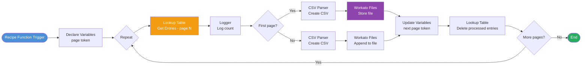

# Copy of Download Lookup Table data - AdHoc

| Field | Value |
|-------|-------|
| **Recipe ID** | `74234941` |
| **Status** | 🔴 Stopped |
| **Trigger** | Workato Recipe Function |
| **Applications** | Workato Recipe Function, Workato Variable, Lookup Table, Logger, CSV Parser, Workato Files |

## Overview

A copy/clone of the "Download Lookup Table data - AdHoc" recipe. Reads all entries from a Workato Lookup Table, writes them to a CSV file, then deletes the entries from the table in a paginated loop.

**Purpose:** Ad-hoc utility to export and clear a Lookup Table (archival or debugging). This copy was likely created for testing or a one-off run.

## Trigger

Called manually via Recipe Function

## Data Flow Summary

| | Detail |
|---|---|
| **Source** | Workato Lookup Table |
| **Transformations** | • Get first page of lookup table entries
• Convert to CSV, store file (first chunk)
• Loop: get next page, append to file, delete processed entries, repeat until empty |
| **Destination** | Workato Files (CSV export) |

## Data Flow Diagram

## Step-by-Step Breakdown

- **[Trigger] Workato Recipe Function: Recipe Function trigger**
- **Workato Variable: Declare variable**
- **Repeat / While loop**
  - **Lookup Table: Get entries**
  - **Logger: Log message**
  - **If condition**
    - **CSV Parser: Create CSV lines**
    - **Workato Files: Store file**
  - **If condition**
    - **CSV Parser: Create CSV lines**
    - **Workato Files: Append to file**
  - **Workato Variable: Update variables**
  - **Lookup Table: Delete entries**
  - **While condition check**

---
*Generated from Workato recipe ID 74234941*
