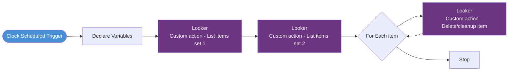

# Copy of Looker Cleanup

| Field | Value |
|-------|-------|
| **Recipe ID** | `66667556` |
| **Status** | 🔴 Stopped |
| **Trigger** | Scheduler (Clock) |
| **Applications** | Scheduler (Clock), Workato Variable, Looker |

## Overview

A copy of the Looker Cleanup recipe. Runs on a schedule, calls Looker custom API actions to list and clean up stale or orphaned Looker content, iterating over results to delete or archive items.

**Purpose:** Automated Looker housekeeping — removes stale dashboards, looks, or user sessions on a schedule (copy likely used for testing).

## Trigger

Scheduler (Clock)

## Data Flow Summary

| | Detail |
|---|---|
| **Source** | Looker (via custom connector) |
| **Transformations** | • Declare working variables
• Looker: list items (action 1)
• Looker: list items (action 2)
• For each item: call Looker delete/cleanup action |
| **Destination** | Looker (items deleted/cleaned) |

## Data Flow Diagram

## Step-by-Step Breakdown

- **[Trigger] Scheduler (Clock): Scheduled trigger**
- **Workato Variable: Declare variable**
- **Looker: Custom API action**
- **Looker: Custom API action**
- **For Each loop**
  - **Looker: Custom API action**
- **Stop job**

---
*Generated from Workato recipe ID 66667556*
