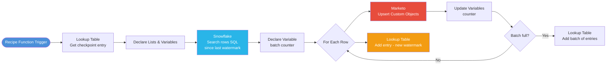

# Copy of Marketo NM Dynamic Data Ingest

| Field | Value |
|-------|-------|
| **Recipe ID** | `72460703` |
| **Status** | 🔴 Stopped |
| **Trigger** | Workato Recipe Function |
| **Applications** | Workato Recipe Function, Lookup Table, Workato Variable, Snowflake, Marketo |

## Overview

A copy of the Marketo NM Dynamic Data Ingest recipe. Reads a checkpoint from a Lookup Table, queries Snowflake for NM records since the last run, and upserts them as Marketo custom objects in batches, updating the checkpoint afterward.

**Purpose:** CDC (Change Data Capture) pattern: incrementally syncs NM data from Snowflake to Marketo custom objects, using a Lookup Table as a persistent watermark.

## Trigger

Called manually via Recipe Function (copy — not in production)

## Data Flow Summary

| | Detail |
|---|---|
| **Source** | Snowflake (NM records), Lookup Table (watermark/checkpoint) |
| **Transformations** | • Read watermark (last processed ID or timestamp) from Lookup Table
• Query Snowflake for records since watermark
• Batch upsert records to Marketo custom objects
• Update watermark in Lookup Table |
| **Destination** | Marketo (custom objects), Lookup Table (updated checkpoint) |

## Data Flow Diagram

## Step-by-Step Breakdown

- **[Trigger] Workato Recipe Function: Recipe Function trigger**
- **Lookup Table: Get entries**
- **Workato Variable: Declare list**
- **Workato Variable: Declare variable**
- **Snowflake: Search rows (SQL)**
- **Workato Variable: Declare variable**
- **For Each loop**
  - **Marketo: Upsert custom objects**
  - **Workato Variable: Update variables**
  - **If condition**
    - **Lookup Table: Add batch of entries**
- **Lookup Table: Add entry**

---
*Generated from Workato recipe ID 72460703*
