# Download Lookup Table data - AdHoc

| Field | Value |
|-------|-------|
| **Recipe ID** | `72426081` |
| **Status** | 🔴 Stopped |
| **Trigger** | Workato Recipe Function |
| **Applications** | Workato Recipe Function, Workato Variable, Lookup Table, Logger, CSV Parser, Workato Files |

## Overview

An ad-hoc utility recipe that exports all entries from a Workato Lookup Table into a CSV file and deletes them from the table as it goes, using pagination to handle large tables.

**Purpose:** Provides a safe way to archive and clear a Lookup Table, ensuring data is captured before deletion.

## Trigger

Called manually via Recipe Function

## Data Flow Summary

| | Detail |
|---|---|
| **Source** | Workato Lookup Table |
| **Transformations** | • Get first page → create CSV → store file → delete entries
• Repeat: get next page → append CSV → delete → until empty |
| **Destination** | Workato Files (CSV archive) |

## Data Flow Diagram

```mermaid
flowchart LR
    A([Recipe Function Trigger]) --> B[Declare Variables]
    B --> C[Lookup Table\nGet first page]
    C --> D[Logger\nLog count]
    D --> E[CSV Parser\nCreate CSV lines]
    E --> F[Workato Files\nStore file]
    F --> G[Lookup Table\nDelete first page entries]
    G --> H{Repeat}
    H --> I[Lookup Table\nGet next page]
    I --> J[Logger\nLog count]
    J --> K[CSV Parser\nCreate CSV lines]
    K --> L[Workato Files\nAppend to file]
    L --> M[Update Variables\nnext page token]
    M --> N[Lookup Table\nDelete entries]
    N --> O{More?}
    O -- Yes --> H
    O -- No --> P([End])
    style A fill:#4a90d9,color:#fff
    style P fill:#27ae60,color:#fff
    style C fill:#f39c12,color:#fff
    style F fill:#8e44ad,color:#fff
```

## Step-by-Step Breakdown

- **[Trigger] Workato Recipe Function: Recipe Function trigger**
- **Workato Variable: Declare variable**
- **Lookup Table: Get entries**
- **Logger: Log message**
- **CSV Parser: Create CSV lines**
- **Workato Files: Store file**
- **Lookup Table: Delete entries**
- **Repeat / While loop**
  - **Lookup Table: Get entries**
  - **Logger: Log message**
  - **CSV Parser: Create CSV lines**
  - **Workato Files: Append to file**
  - **Workato Variable: Update variables**
  - **Lookup Table: Delete entries**
  - **While condition check**

---
*Generated from Workato recipe ID 72426081*
