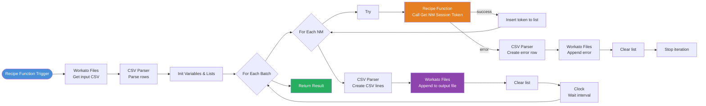

# Download NM session token in bulk

| Field | Value |
|-------|-------|
| **Recipe ID** | `82745439` |
| **Status** | 🔴 Stopped |
| **Trigger** | Workato Recipe Function |
| **Applications** | Workato Recipe Function, Workato Files, CSV Parser, Workato Variable, Scheduler (Clock) |

## Overview

An on-demand recipe that reads a CSV of Network Members, calls the "Get NM Session Token" sub-recipe for each member (with retry/error handling), collects the tokens, writes them to a CSV output file, and waits between batches to respect rate limits.

**Purpose:** Bulk-retrieves authentication session tokens for a list of network members so downstream processes can act on their behalf without individual logins.

## Trigger

Called manually via Recipe Function

## Data Flow Summary

| | Detail |
|---|---|
| **Source** | Workato Files (CSV of NM identifiers) |
| **Transformations** | • Parse CSV into NM rows
• Nested for-each: for each NM, call Get NM Session Token sub-recipe
• On error: write failure row to error CSV, stop that iteration
• Collect tokens into a list, convert to CSV rows, flush to output file
• Wait between outer batches (rate-limit buffer) |
| **Destination** | Workato Files (output CSV of NM session tokens) |

## Data Flow Diagram

## Step-by-Step Breakdown

- **[Trigger] Workato Recipe Function: Recipe Function trigger**
- **Workato Files: Get file contents**
- **CSV Parser: Parse CSV**
- **Workato Variable: Declare variable**
- **Workato Variable: Declare list**
- **Workato Files: Store file**
- **For Each loop**
  - **For Each loop**
    - **Try block**
      - **Workato Recipe Function: Call sub-recipe**
      - **Catch (error handler)**
        - **CSV Parser: Create CSV lines**
        - **Workato Files: Append to file**
        - **Workato Variable: Clear list**
        - **Stop job**
    - **Workato Variable: Insert to list**
  - **CSV Parser: Create CSV lines**
  - **Workato Files: Append to file**
  - **Workato Variable: Clear list**
  - **Scheduler (Clock): Wait / sleep**
- **Workato Recipe Function: Return result**

---
*Generated from Workato recipe ID 82745439*
