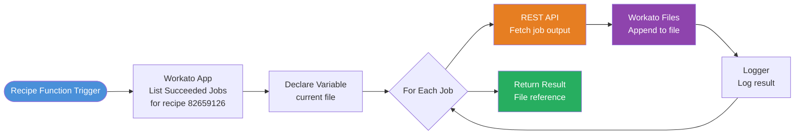

# download recipe return in bulk

| Field | Value |
|-------|-------|
| **Recipe ID** | `82864310` |
| **Status** | 🔴 Stopped |
| **Trigger** | Workato Recipe Function |
| **Applications** | Workato Recipe Function, Workato App, Workato Variable, REST API, Workato Files, Logger |

## Overview

An on-demand utility recipe that lists succeeded jobs from the "Get NM Session Token" recipe within a specified time window, calls a REST API for each job to fetch the returned output, appends the results to a Workato file, and returns the aggregated file.

**Purpose:** Provides a bulk download mechanism for session token results produced by the Get NM Session Token recipe within a given time window, allowing ad-hoc data extraction without re-running individual jobs.

## Trigger

Called manually via Recipe Function (another recipe or the Workato UI)

## Data Flow Summary

| | Detail |
|---|---|
| **Source** | Workato App (Recipe Job History for recipe 82659126) |
| **Transformations** | • Filters jobs by "succeeded" status and date range
• For each job, calls a REST API endpoint to retrieve the job output
• Appends each result row to a Workato-managed file (CSV/text) |
| **Destination** | Workato Files (aggregated output file) |

## Data Flow Diagram

## Step-by-Step Breakdown

- **[Trigger] Workato Recipe Function: Recipe Function trigger**
- **Workato App: List recipe jobs**
- **Workato Variable: Declare variable**
- **For Each loop**
  - **REST API: Make HTTP request**
  - **Workato Files: Append to file**
  - **Logger: Log message**
- **Workato Recipe Function: Return result**

---
*Generated from Workato recipe ID 82864310*
