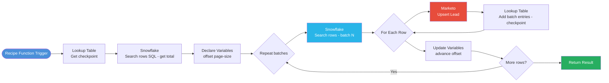

# Final- Update User Metrics on Marketo

| Field | Value |
|-------|-------|
| **Recipe ID** | `68364260` |
| **Status** | 🔴 Stopped |
| **Trigger** | Workato Recipe Function |
| **Applications** | Workato Recipe Function, Lookup Table, Snowflake, Workato Variable, Marketo |

## Overview

An on-demand sub-recipe that reads a pagination checkpoint from a Lookup Table, queries Snowflake for user metric rows in batches, upserts each batch to Marketo as leads, and updates the Lookup Table checkpoint.

**Purpose:** Manual single-shot version of the user metrics sync, intended to run a specific segment or complete backfill of user metrics into Marketo.

## Trigger

Called manually via Recipe Function

## Data Flow Summary

| | Detail |
|---|---|
| **Source** | Snowflake (user metrics), Lookup Table (pagination state) |
| **Transformations** | • Get current page offset from Lookup Table
• Query Snowflake for metric rows from that offset
• For each row: upsert to Marketo as lead, batch-write checkpoint back to Lookup Table
• Advance offset until all rows processed |
| **Destination** | Marketo (lead metrics fields) |

## Data Flow Diagram

## Step-by-Step Breakdown

- **[Trigger] Workato Recipe Function: Recipe Function trigger**
- **Lookup Table: Get entries**
- **Snowflake: Search rows (SQL)**
- **Workato Variable: Declare variable**
- **Workato Variable: Declare variable**
- **Repeat / While loop**
  - **Snowflake: Search rows**
  - **For Each loop**
    - **Marketo: Upsert lead**
    - **Lookup Table: Add batch of entries**
  - **Workato Variable: Update variables**
  - **While condition check**
- **Workato Recipe Function: Return result**

---
*Generated from Workato recipe ID 68364260*
