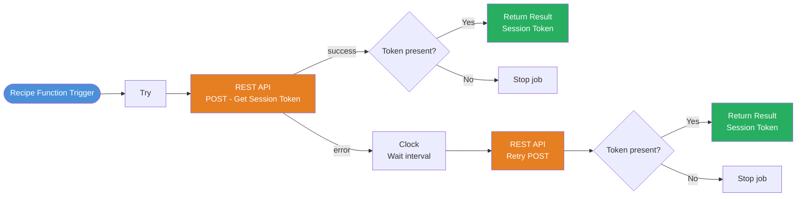

# Get NM Session Token

| Field | Value |
|-------|-------|
| **Recipe ID** | `82659126` |
| **Status** | 🟢 Running |
| **Trigger** | Workato Recipe Function |
| **Applications** | Workato Recipe Function, REST API, Scheduler (Clock) |

## Overview

A lightweight callable sub-recipe that authenticates against an external REST API (NM platform) to obtain a session token. Includes a single retry with a wait on failure, returning the token or stopping the job.

**Purpose:** Centralizes NM session-token acquisition so other recipes can call this function rather than duplicating authentication logic.

## Trigger

Called by other recipes via Recipe Function

## Data Flow Summary

| | Detail |
|---|---|
| **Source** | External NM REST API (OAuth / session endpoint) |
| **Transformations** | • POST credentials to REST endpoint
• On failure: wait, retry once
• Return token or stop job |
| **Destination** | Returns session token to calling recipe |

## Data Flow Diagram

## Step-by-Step Breakdown

- **[Trigger] Workato Recipe Function: Recipe Function trigger**
- **Try block**
  - **REST API: Make HTTP request**
  - **Catch (error handler)**
    - **Scheduler (Clock): Wait / sleep**
    - **REST API: Make HTTP request**
    - **If condition**
      - **Workato Recipe Function: Return result**
    - **Stop job**
- **If condition**
  - **Workato Recipe Function: Return result**
- **Stop job**

---
*Generated from Workato recipe ID 82659126*
