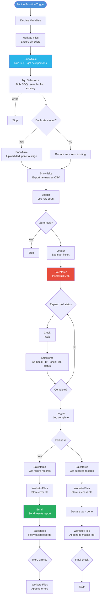

# Law - New Person Contact Creation (Bulk CSV)

| Field | Value |
|-------|-------|
| **Recipe ID** | `82464098` |
| **Status** | 🟢 Running |
| **Trigger** | Workato Recipe Function |
| **Applications** | Workato Recipe Function, Workato Variable, Workato Files, Snowflake, Salesforce, Logger, Scheduler (Clock), Email |

## Overview

An on-demand recipe that creates new Salesforce Contacts from a bulk CSV. It queries Snowflake for new person records, searches Salesforce to avoid duplicates, stages data, inserts via Salesforce Bulk API, polls until complete, and emails a results report.

**Purpose:** Automates large-scale contact creation for law-segment persons, reconciling Snowflake as source-of-truth against Salesforce to prevent duplicates.

## Trigger

Called manually via Recipe Function

## Data Flow Summary

| | Detail |
|---|---|
| **Source** | Snowflake (person data), Salesforce (duplicate check) |
| **Transformations** | • Run Snowflake SQL to get new person records
• Bulk-search Salesforce SOQL to identify existing contacts
• Upload dedup results to Snowflake internal stage
• Export net-new records as CSV from Snowflake
• Insert via Salesforce Bulk Job API
• Poll for job completion (repeat + wait)
• On failure: download error file, send email, retry
• Append outcome rows to result file |
| **Destination** | Salesforce (new Contacts), Email (results report) |

## Data Flow Diagram

## Step-by-Step Breakdown

- **[Trigger] Workato Recipe Function: Recipe Function trigger**
- **Workato Variable: Declare variable**
- **Workato Files: Ensure directory exists**
- **Snowflake: Run custom SQL**
- **Try block**
  - **Salesforce: Search sObjects (SOQL bulk)**
  - **Catch (error handler)**
    - **Stop job**
- **If condition**
  - **Snowflake: Upload to internal stage**
  - **Workato Variable: Declare variable**
  - **Else branch**
    - **Workato Variable: Declare variable**
- **Snowflake: Export CSV**
- **Logger: Log message**
- **If condition**
  - **Stop job**
- **Logger: Log message**
- **If condition**
  - **Stop job**
- **Salesforce: Insert (bulk job)**
- **Repeat / While loop**
  - **Scheduler (Clock): Wait / sleep**
  - **Salesforce: Ad-hoc HTTP action**
  - **While condition check**
- **Logger: Log message**
- **If condition**
  - **Salesforce: Ad-hoc HTTP action**
  - **Workato Files: Store file**
  - **Email: Send email**
  - **Salesforce: Retry bulk jobs**
  - **If condition**
    - **Workato Files: Append to file**
  - **If condition**
- **If condition**
  - **Salesforce: Ad-hoc HTTP action**
  - **Workato Files: Store file**
- **Workato Variable: Declare variable**
- **Workato Files: Append to file**
- **If condition**
  - **Stop job**

---
*Generated from Workato recipe ID 82464098*
