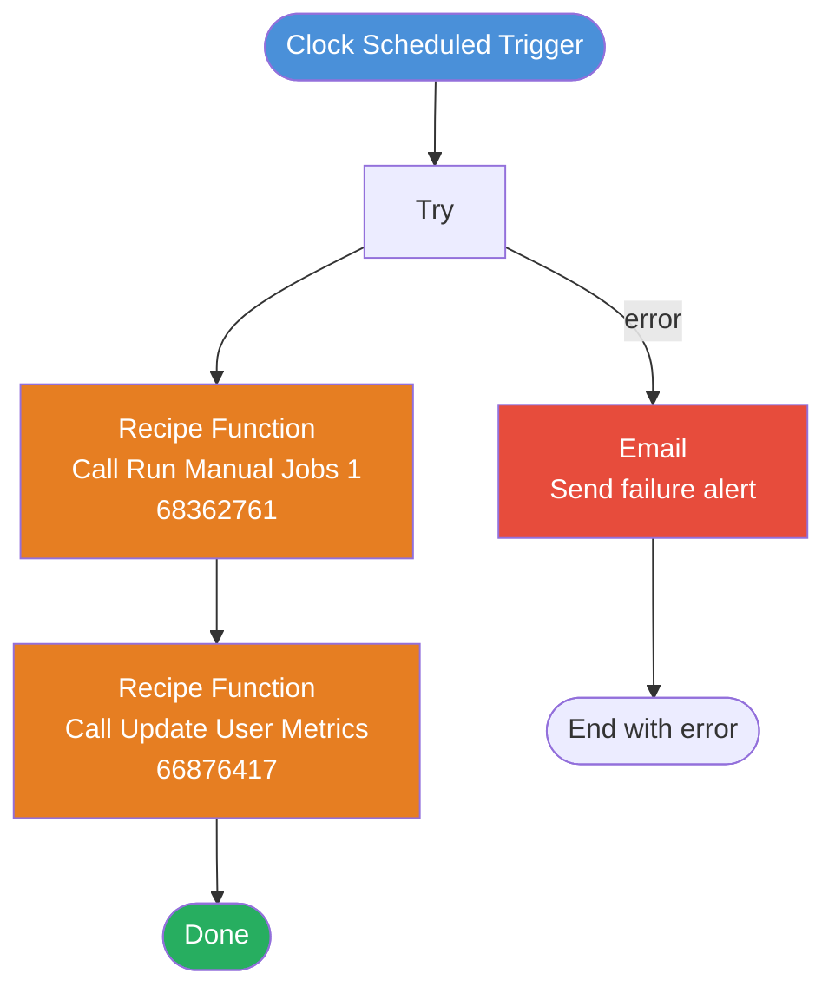

# Marketo Update User Metrics Billable

| Field | Value |
|-------|-------|
| **Recipe ID** | `66877883` |
| **Status** | 🟢 Running |
| **Trigger** | Scheduler (Clock) |
| **Applications** | Scheduler (Clock), Workato Recipe Function, Email |

## Overview

The top-level scheduler recipe for the user metrics pipeline. Runs on a schedule, calls two sub-recipes sequentially (Job 1 and Update User Metrics), and emails an alert if either fails.

**Purpose:** Orchestrates the daily/recurring user metrics update pipeline by coordinating Job 1 and the core update recipe, with failure alerting.

## Trigger

Scheduler (Clock) — recurring cron schedule

## Data Flow Summary

| | Detail |
|---|---|
| **Source** | Triggers sub-recipes 68362761 and 66876417 |
| **Transformations** | • Call Job 1 sub-recipe synchronously
• Call Update User Metrics sub-recipe synchronously
• On any error: send failure email notification |
| **Destination** | Email (failure alerts), delegates to sub-recipes |

## Data Flow Diagram

## Step-by-Step Breakdown

- **[Trigger] Scheduler (Clock): Scheduled trigger**
- **Try block**
  - **Workato Recipe Function: Call sub-recipe**
  - **Workato Recipe Function: Call sub-recipe**
  - **Catch (error handler)**
    - **Email: Send email**

---
*Generated from Workato recipe ID 66877883*
