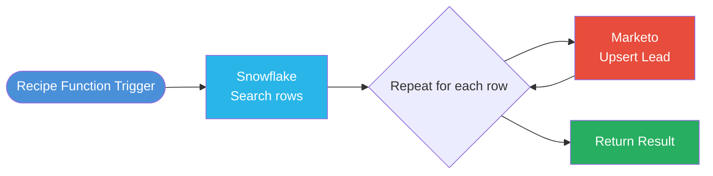

# Mohit-Test

| Field | Value |
|-------|-------|
| **Recipe ID** | `72018777` |
| **Status** | 🔴 Stopped |
| **Trigger** | Workato Recipe Function |
| **Applications** | Workato Recipe Function, Snowflake, Marketo |

## Overview

A test recipe by Mohit that queries Snowflake and upserts each result row as a Marketo lead in a repeat loop, then returns the result count.

**Purpose:** Developer test harness for validating Snowflake-to-Marketo lead upsert logic.

## Trigger

Called manually via Recipe Function

## Data Flow Summary

| | Detail |
|---|---|
| **Source** | Snowflake |
| **Transformations** | • Search Snowflake rows
• Repeat: upsert each row as a Marketo lead |
| **Destination** | Marketo (leads) |

## Data Flow Diagram

## Step-by-Step Breakdown

- **[Trigger] Workato Recipe Function: Recipe Function trigger**
- **Snowflake: Search rows**
- **Repeat / While loop**
  - **Marketo: Upsert lead**
  - **While condition check**
- **Workato Recipe Function: Return result**

---
*Generated from Workato recipe ID 72018777*
