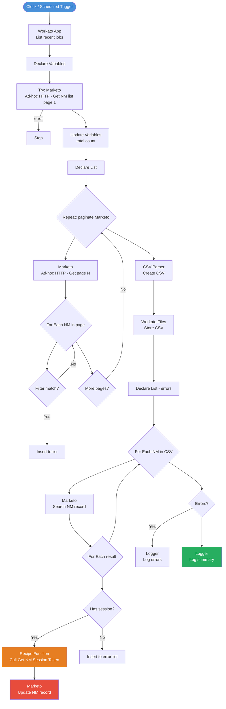

# NM Payment Link Refresh

| Field | Value |
|-------|-------|
| **Recipe ID** | `82681430` |
| **Status** | 🟢 Running |
| **Trigger** | Scheduler (Clock) |
| **Applications** | Scheduler (Clock), Workato App, Workato Variable, Marketo, CSV Parser, Workato Files, Workato Recipe Function, Logger |

## Overview

A scheduled recipe that runs on a cron trigger, checks for completed NM session-token jobs, calls Marketo APIs to paginate and collect network member records needing payment link updates, generates a CSV, then for each NM calls the "Get NM Session Token" sub-recipe and updates the Marketo record with the refreshed link.

**Purpose:** Automatically refreshes Marketo payment-link fields for network members on a schedule, keeping links current without manual intervention.

## Trigger

Scheduler (cron/clock) — recurring schedule

## Data Flow Summary

| | Detail |
|---|---|
| **Source** | Marketo (NM lead records), Workato App (job history) |
| **Transformations** | • List recent succeeded jobs to detect prior run state
• Paginate Marketo via ad-hoc HTTP calls to fetch NM records
• Build a CSV of NMs needing refresh
• For each NM: search Marketo, call Get NM Session Token sub-recipe, update Marketo record
• Track failures in a separate list; log results |
| **Destination** | Marketo (updated NM lead fields) |

## Data Flow Diagram

## Step-by-Step Breakdown

- **[Trigger] Scheduler (Clock): Scheduled trigger**
- **Workato App: List recipe jobs**
- **Workato Variable: Declare variable**
- **Try block**
  - **Marketo: Ad-hoc HTTP action**
  - **Catch (error handler)**
    - **Stop job**
- **Workato Variable: Update variables**
- **Workato Variable: Declare list**
- **Repeat / While loop**
  - **Marketo: Ad-hoc HTTP action**
  - **For Each loop**
    - **If condition**
      - **Workato Variable: Insert to list**
  - **If condition**
    - **Stop job**
  - **Workato Variable: Update variables**
  - **While condition check**
- **CSV Parser: Create CSV lines**
- **Workato Files: Store file**
- **Workato Variable: Declare list**
- **For Each loop**
  - **Marketo: Search objects**
  - **For Each loop**
    - **If condition**
      - **Workato Recipe Function: Call sub-recipe**
      - **Marketo: Update objects**
      - **Else branch**
        - **Workato Variable: Insert to list**
- **If condition**
  - **Logger: Log message**
- **Logger: Log message**

---
*Generated from Workato recipe ID 82681430*
