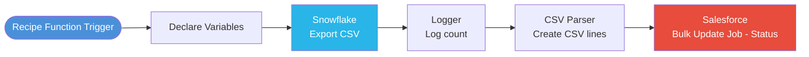

# Prod Test - Salesforce Contact Update Status

| Field | Value |
|-------|-------|
| **Recipe ID** | `74211701` |
| **Status** | 🔴 Stopped |
| **Trigger** | Workato Recipe Function |
| **Applications** | Workato Recipe Function, Workato Variable, Snowflake, Logger, CSV Parser, Salesforce |

## Overview

A test recipe for updating Salesforce Contact Status fields using data from Snowflake. Nearly identical to recipe 74699130 but focused on status-field updates.

**Purpose:** Test harness for the Contact Status update flow before production deployment.

## Trigger

Called manually via Recipe Function

## Data Flow Summary

| | Detail |
|---|---|
| **Source** | Snowflake (contact status data) |
| **Transformations** | • Export Snowflake rows as CSV
• Build CSV payload
• Salesforce bulk update job for status fields |
| **Destination** | Salesforce (Contact status updates) |

## Data Flow Diagram

## Step-by-Step Breakdown

- **[Trigger] Workato Recipe Function: Recipe Function trigger**
- **Workato Variable: Declare variable**
- **Snowflake: Export CSV**
- **Logger: Log message**
- **CSV Parser: Create CSV lines**
- **Salesforce: Update (bulk job)**

---
*Generated from Workato recipe ID 74211701*
