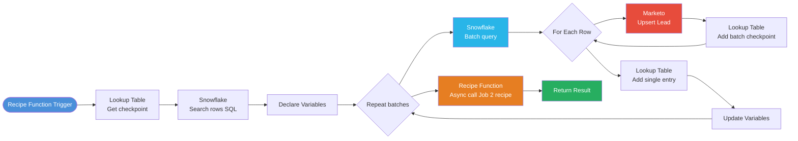

# Run Manual Jobs 1- Update User Metrics on Marketo

| Field | Value |
|-------|-------|
| **Recipe ID** | `68362761` |
| **Status** | 🔴 Stopped |
| **Trigger** | Workato Recipe Function |
| **Applications** | Workato Recipe Function, Lookup Table, Snowflake, Workato Variable, Marketo |

## Overview

First of two manual job sub-recipes for the user metrics sync. Paginates through Snowflake user metric rows, upserts them to Marketo in batches, writes checkpoints to Lookup Table, then asynchronously triggers a second sub-recipe before returning.

**Purpose:** Handles the first half of a large user-metrics backfill, then hands off to Job 2 (68364254) asynchronously to avoid timeout limits.

## Trigger

Called manually via Recipe Function

## Data Flow Summary

| | Detail |
|---|---|
| **Source** | Snowflake (user metrics), Lookup Table (checkpoint) |
| **Transformations** | • Read offset from Lookup Table
• Paginate Snowflake
• Upsert to Marketo per row
• Checkpoint per batch
• Async call to Job 2 recipe |
| **Destination** | Marketo (lead metrics), Lookup Table (checkpoints), Recipe Function (async handoff to Job 2) |

## Data Flow Diagram

## Step-by-Step Breakdown

- **[Trigger] Workato Recipe Function: Recipe Function trigger**
- **Lookup Table: Get entries**
- **Snowflake: Search rows (SQL)**
- **Workato Variable: Declare variable**
- **Workato Variable: Declare variable**
- **Repeat / While loop**
  - **Snowflake: Search rows**
  - **For Each loop**
    - **Marketo: Upsert lead**
    - **Lookup Table: Add batch of entries**
  - **Lookup Table: Add entry**
  - **Workato Variable: Update variables**
  - **While condition check**
- **Workato Recipe Function: Call sub-recipe (async)**
- **Workato Recipe Function: Return result**

---
*Generated from Workato recipe ID 68362761*
