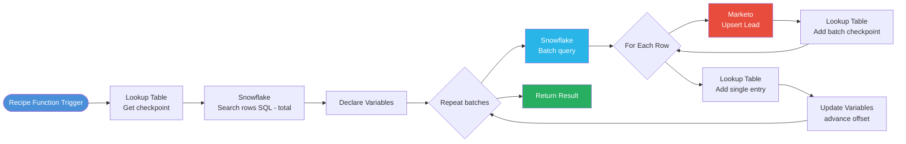

# Run Manual Jobs 2- Update User Metrics on Marketo

| Field | Value |
|-------|-------|
| **Recipe ID** | `68364254` |
| **Status** | 🔴 Stopped |
| **Trigger** | Workato Recipe Function |
| **Applications** | Workato Recipe Function, Lookup Table, Snowflake, Workato Variable, Marketo |

## Overview

Nearly identical to recipe 68362761 (Run Manual Jobs 1). Reads pagination state from Lookup Table, batch-queries Snowflake, upserts rows to Marketo, and writes a checkpoint entry per batch.

**Purpose:** Second manual job in a split strategy for large user metrics syncs — handles a different segment or time window than Job 1.

## Trigger

Called manually via Recipe Function

## Data Flow Summary

| | Detail |
|---|---|
| **Source** | Snowflake (user metrics), Lookup Table (checkpoint) |
| **Transformations** | • Get offset from Lookup Table
• Paginate Snowflake in batches
• Upsert each row to Marketo
• Checkpoint each batch in Lookup Table |
| **Destination** | Marketo (lead metrics), Lookup Table (checkpoints) |

## Data Flow Diagram

## Step-by-Step Breakdown

- **[Trigger] Workato Recipe Function: Recipe Function trigger**
- **Lookup Table: Get entries**
- **Snowflake: Search rows (SQL)**
- **Workato Variable: Declare variable**
- **Workato Variable: Declare variable**
- **Repeat / While loop**
  - **Snowflake: Search rows**
  - **For Each loop**
    - **Marketo: Upsert lead**
    - **Lookup Table: Add batch of entries**
  - **Lookup Table: Add entry**
  - **Workato Variable: Update variables**
  - **While condition check**
- **Workato Recipe Function: Return result**

---
*Generated from Workato recipe ID 68364254*
