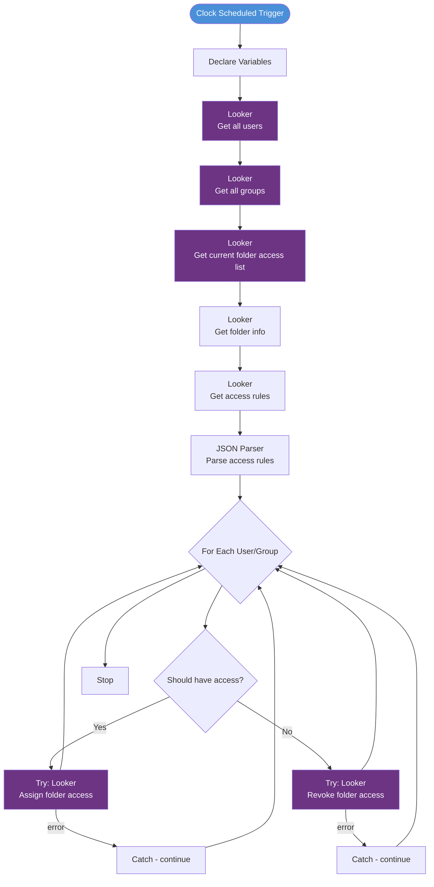

# Update Folder Access

| Field | Value |
|-------|-------|
| **Recipe ID** | `63949093` |
| **Status** | 🟢 Running |
| **Trigger** | Scheduler (Clock) |
| **Applications** | Scheduler (Clock), Workato Variable, Looker, JSON Parser |

## Overview

A scheduled recipe that updates Looker folder access permissions. It retrieves user and group lists from Looker, parses the JSON, and for each user/group conditionally assigns or revokes folder access, with error handling per item.

**Purpose:** Keeps Looker folder ACLs in sync with the current org structure automatically, reducing manual permission management.

## Trigger

Scheduler (Clock) — recurring schedule

## Data Flow Summary

| | Detail |
|---|---|
| **Source** | Looker (users, groups, folder permissions via custom API) |
| **Transformations** | • Declare variables for state tracking
• Looker: get all users (action 1)
• Looker: get all groups (action 2)
• Looker: get current folder access list (action 3)
• Looker: get target folder info (action 4)
• Looker: get access rules (action 5)
• Parse JSON response
• For each user/group: check if access should be granted or revoked
• Try: assign access; Catch errors silently
• Try: revoke access; Catch errors silently |
| **Destination** | Looker (folder access permissions updated) |

## Data Flow Diagram

## Step-by-Step Breakdown

- **[Trigger] Scheduler (Clock): Scheduled trigger**
- **Workato Variable: Declare variable**
- **Looker: Custom API action**
- **Looker: Custom API action**
- **Looker: Custom API action**
- **Looker: Custom API action**
- **Looker: Custom API action**
- **JSON Parser: Parse JSON**
- **For Each loop**
  - **If condition**
    - **Try block**
      - **Looker: Custom API action**
      - **JSON Parser: Parse JSON**
      - **Catch (error handler)**
    - **Try block**
      - **Looker: Custom API action**
      - **Catch (error handler)**
- **Stop job**

---
*Generated from Workato recipe ID 63949093*
