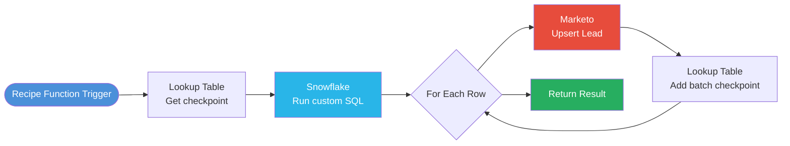

# Update User Metrics on Marketo

| Field | Value |
|-------|-------|
| **Recipe ID** | `66876417` |
| **Status** | 🟢 Running |
| **Trigger** | Workato Recipe Function |
| **Applications** | Workato Recipe Function, Lookup Table, Snowflake, Marketo |

## Overview

The core user metrics update sub-recipe. Reads pagination state from a Lookup Table, runs a custom Snowflake SQL query, and for each result row upserts a Marketo lead and batches checkpoints back to the Lookup Table.

**Purpose:** Performs the actual Snowflake → Marketo data sync for user metrics in a single efficient pass, acting as the workhorse called by the scheduler recipe.

## Trigger

Called by other recipes via Recipe Function

## Data Flow Summary

| | Detail |
|---|---|
| **Source** | Snowflake (user metrics via custom SQL), Lookup Table (state) |
| **Transformations** | • Get pagination checkpoint from Lookup Table
• Run custom SQL on Snowflake
• For each row: upsert to Marketo as lead
• Batch-write checkpoints to Lookup Table |
| **Destination** | Marketo (lead fields), Lookup Table (checkpoints) |

## Data Flow Diagram

## Step-by-Step Breakdown

- **[Trigger] Workato Recipe Function: Recipe Function trigger**
- **Lookup Table: Get entries**
- **Snowflake: Run custom SQL**
- **For Each loop**
  - **Marketo: Upsert lead**
  - **Lookup Table: Add batch of entries**
- **Workato Recipe Function: Return result**

---
*Generated from Workato recipe ID 66876417*
