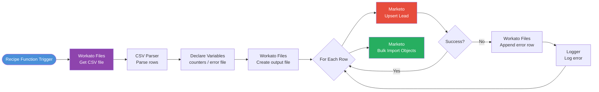

# Upload RTI payment links in bulk

| Field | Value |
|-------|-------|
| **Recipe ID** | `82843346` |
| **Status** | 🔴 Stopped |
| **Trigger** | Workato Recipe Function |
| **Applications** | Workato Recipe Function, Workato Files, CSV Parser, Workato Variable, Marketo, Logger |

## Overview

An on-demand recipe that reads a CSV file of Network Member (NM) payment links from Workato Files, parses it, and upserts each row as a Marketo lead. Failed rows are tracked in an error file and a final bulk import finalizes the Marketo data.

**Purpose:** Bulk-uploads RTI payment link data into Marketo so network members receive personalized payment URLs via email campaigns.

## Trigger

Called manually via Recipe Function

## Data Flow Summary

| | Detail |
|---|---|
| **Source** | Workato Files (CSV with NM payment links) |
| **Transformations** | • Parse CSV into rows
• For each row: upsert to Marketo as a lead (create or update by email)
• Track failures in a separate error file
• Final bulk import of all objects to Marketo |
| **Destination** | Marketo (leads / persons) |

## Data Flow Diagram

## Step-by-Step Breakdown

- **[Trigger] Workato Recipe Function: Recipe Function trigger**
- **Workato Files: Get file contents**
- **CSV Parser: Parse CSV**
- **Workato Variable: Declare variable**
- **Workato Files: Store file**
- **For Each loop**
  - **Marketo: Upsert lead**
  - **If condition**
    - **Workato Files: Append to file**
    - **Logger: Log message**
- **Marketo: Bulk import objects**

---
*Generated from Workato recipe ID 82843346*
